Proyecto ingenieria de datos Snowflake y AWS

1. Descripción General

Este proyecto implementa una solución completa de Ingeniería de Datos utilizando AWS S3, Snowflake, Apache Airflow, Slack y Python.

La solución permite:

Ingestar datos desde Kaggle.
Almacenar datos en AWS S3.
Procesar información utilizando una arquitectura Medallion (Bronze, Silver y Gold).
Generar datos sintéticos para simular cargas incrementales.
Orquestar procesos con Apache Airflow.
Enviar notificaciones a Slack.
Exportar datos procesados nuevamente a AWS S3.

2. Arquitectura General
   
Arquitectura de Datos
Dataset Meetup (Kaggle)
            │
            ▼
      AWS S3 Landing
  raw/meetup/initial
            │
            ▼
      Snowflake Bronze
            │
            ▼
      Snowflake Silver
            │
            ▼
       Snowflake Gold
       Modelo Estrella
            │
            ▼
      AWS S3 Export
      exports/gold

Orquestación

Apache Airflow
       │
       ▼
Generación Datos Sintéticos
       │
       ▼
Carga Bronze
       │
       ▼
Carga Silver
       │
       ▼
Carga Gold
       │
       ▼
Exportación S3
       │
       ▼
Alertas Slack

3. Tecnologías Utilizadas
   
Python
Snowflake
AWS S3
Apache Airflow
Docker
Slack
Pandas
Boto3
Snowflake Connector
Kaggle API

4. Dataset Utilizado

Fuente:

https://www.kaggle.com/megelon/meetup

El dataset contiene información relacionada con:

Eventos
Grupos
Ciudades
Categorías
Venues
Miembros
Temáticas

5. Estructura de AWS S3
Landing Zone
raw/
└── meetup/
    ├── initial/
    │   ├── categories.csv
    │   ├── cities.csv
    │   ├── topics.csv
    │   ├── groups_topics.csv
    │   ├── members_topics.csv
    │   ├── members.csv
    │   ├── venues.csv
    │   ├── groups.csv
    │   └── events.csv
    │
    └── incremental/
        └── events/

Export Zone
exports/
└── gold/
    ├── dim_city/
    ├── dim_group/
    ├── dim_venue/
    ├── dim_date/
    └── fact_events/

Captura - Landing Zone en AWS S3

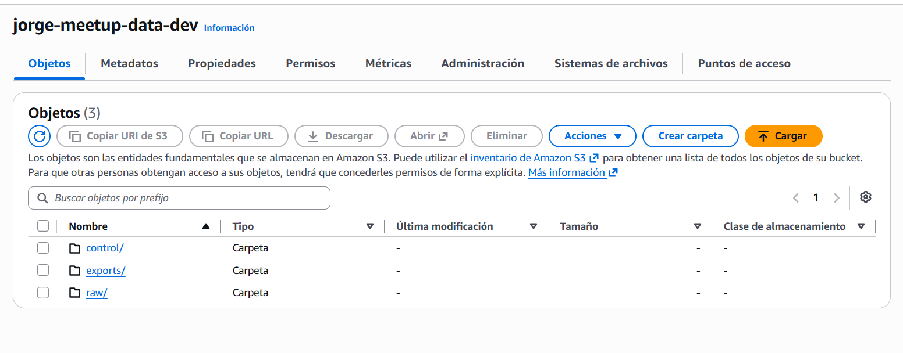

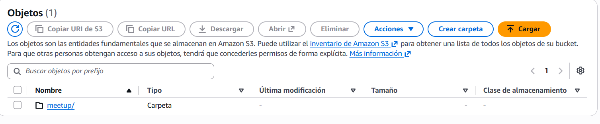

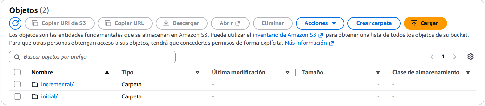

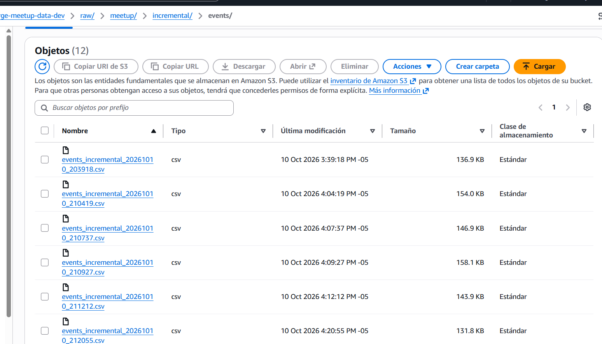

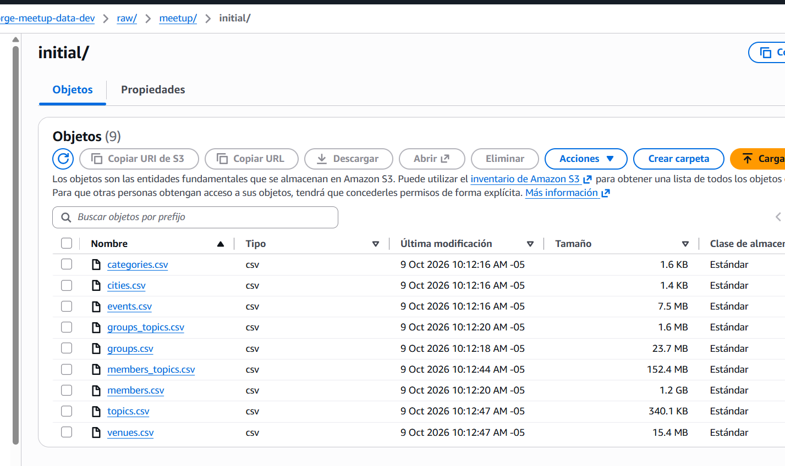

Captura - Export Zone en AWS S3

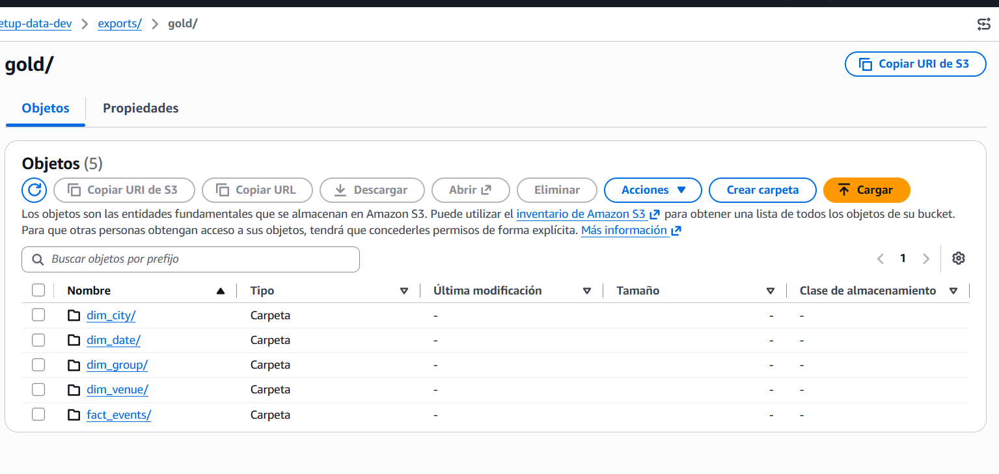

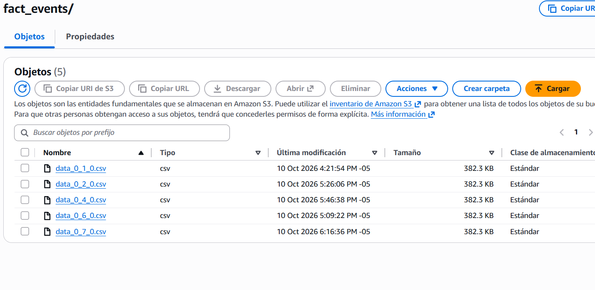

6. Arquitectura en Snowflake
   
Capa Bronze

Capa de almacenamiento de datos crudos.

Tablas:

CATEGORIES_RAW
CITIES_RAW
TOPICS_RAW
GROUPS_TOPICS_RAW
MEMBERS_TOPICS_RAW
MEMBERS_RAW
VENUES_RAW
GROUPS_RAW
EVENTS_RAW

Características:

Conservación de datos originales.
Metadatos de ingestión.
Trazabilidad de archivos.
Auditoría de origen.
Capa Silver

Capa de transformación y estandarización.

Tablas:

CATEGORIES_SILVER
CITIES_SILVER
TOPICS_SILVER
GROUPS_TOPICS_SILVER
MEMBERS_TOPICS_SILVER
MEMBERS_SILVER
VENUES_SILVER
GROUPS_SILVER
EVENTS_SILVER

Características:

Limpieza de datos.
Datos con problemas de calidad se llevan a tablas de cuarentena
Eliminación de duplicados.
Estandarización.
Procesamiento incremental mediante MERGE.

Capa Gold

Modelo dimensional para analítica.

Dimensiones
DIM_CITY
DIM_GROUP
DIM_VENUE
DIM_DATE

Tabla de Hechos
FACT_EVENTS

Características:

Modelo estrella.
Claves sustitutas.
Integridad referencial.
Consultas analíticas optimizadas.

Captura - Tablas Bronze

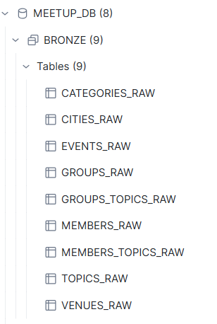

Captura - Tablas Silver

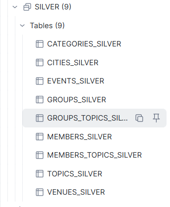

Captura - Tablas Gold

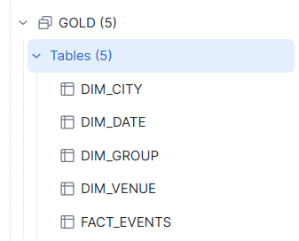

Captura - Tablas de Cuarentena

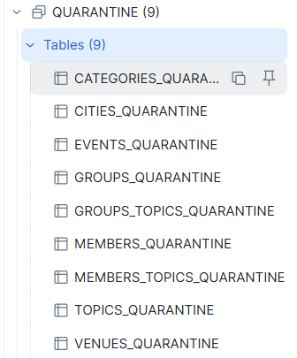

7. Generación de Datos Sintéticos

El dataset original es estático, por lo que se desarrolló un generador de datos sintéticos para simular la llegada continua de información.

Cada ejecución genera:

Actualizaciones de Eventos Existentes

Se modifican aleatoriamente campos como:

YES_RSVP_COUNT
MAYBE_RSVP_COUNT
WAITLIST_COUNT
HEADCOUNT
UPDATED

Creación de Nuevos Eventos

Se generan nuevos registros con:

EVENT_ID
EVENT_NAME
EVENT_TIME
YES_RSVP_COUNT
MAYBE_RSVP_COUNT
WAITLIST_COUNT
HEADCOUNT

Los archivos generados se almacenan en:

raw/meetup/incremental/events/

8. Estrategia de Procesamiento Incremental
Control de Archivos Procesados

Para evitar reprocesamientos se implementó la tabla:

CONTROL.PROCESSED_FILES

La tabla almacena:

FILE_NAME
FILE_PATH
FILE_TYPE
PROCESSED_TIMESTAMP

Beneficios:

Evita cargas duplicadas.
Permite ejecución idempotente.
Facilita auditoría de procesos.
Procesamiento Silver

La carga se realiza mediante:

MERGE

Permitendo:

Inserción de nuevos registros.
Actualización de registros existentes.
Eliminación de duplicados.
Procesamiento Gold

Las dimensiones y la tabla de hechos utilizan:

MERGE

para soportar procesamiento incremental.

9. Notificaciones en Slack

Se configuraron notificaciones automáticas para informar el estado de los procesos.

Eventos notificados:

Bronze Load Completed
Silver Load Completed
Gold Load Completed
Gold Export Completed

Cada mensaje incluye estadísticas y conteos de registros procesados.

Captura - Notificaciones Slack

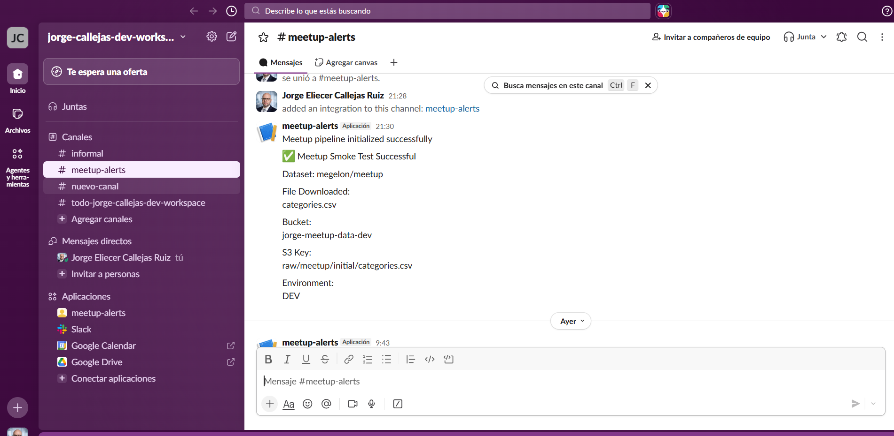

10. Apache Airflow

Airflow permite la automatización y orquestación completa de la solución.

DAG
meetup_pipeline

Frecuencia:

Cada 15 minutos

Cron:

*/15 * * * *

Flujo del DAG
generate_synthetic_data
            │
            ▼
load_bronze
            │
            ▼
load_silver
            │
            ▼
load_gold
            │
            ▼
export_gold

Captura - Lista de DAGs

Insertar captura aquí

Captura - Vista Graph

Insertar captura aquí

Captura - Ejecución Exitosa del DAG

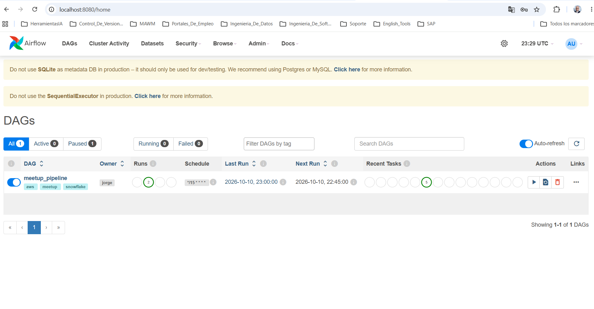

11. Controles de Calidad Implementados
Bronze
Trazabilidad de archivos.
Timestamp de carga.
Origen de los datos.
Silver
Limpieza de datos.
Deduplicación.
Transformación estructurada.
Cargas incrementales.
Gold
Integridad referencial.
Modelo dimensional.
Cargas incrementales.
Operacional
Tabla de control de archivos procesados.
Alertas Slack.
Monitoreo mediante Airflow.

12. Flujo End-to-End
    
13. Generación de datos sintéticos.

14. Almacenamiento en AWS S3.

15. Carga Bronze.

16. Procesamiento Silver.

17. Construcción modelo Gold.

18. Exportación de datos a AWS S3.

19. Notificación mediante Slack.

20. Ejecución automática cada 15 minutos mediante Airflow.

21. Estructura del Repositorio
data-engineering-snowflake/

├── airflow/
│   └── dags/
│
├── bootstrap/
│
├── config/
│
├── pipelines/
│   ├── run_synthetic_generation.py
│   ├── run_bronze_load.py
│   ├── run_silver_load.py
│   ├── run_gold_load.py
│   ├── run_export_gold.py
│   └── run_end_to_end_pipeline.py
│
├── sql/
│   ├── 01_setup/
│   ├── 02_bronze/
│   ├── 03_silver/
│   └── 04_gold/
│
├── src/
│   ├── extractors/
│   ├── loaders/
│   └── utils/
│
└── README.md

14. Conclusiones

La solución desarrollada permite:

* Ingesta automatizada de datos desde Kaggle.

* Procesamiento en arquitectura Medallion (Bronze, Silver y Gold).

* Generación de datos sintéticos para escenarios incrementales.

* Procesamiento incremental mediante MERGE.

 * Exportación de datos procesados a AWS S3.

* Monitoreo y alertas mediante Slack.

* Orquestación completa mediante Apache Airflow.

* Modelo dimensional listo para explotación analítica y herramientas BI.

La plataforma implementa un flujo completo de Ingeniería de Datos moderno, automatizado y escalable, cubriendo todos los requerimientos planteados en la prueba técnica.

Puedes explicarlo así en el README:

15. Cómo usar

Crear las cuentas necesarias

Cree una cuenta en AWS, que será utilizada para almacenar los archivos del pipeline en Amazon S3.
Cree una cuenta en Snowflake, que actuará como Data Warehouse para las capas Bronze, Silver y Gold.
Cree una cuenta en Slack, utilizada para el envío de notificaciones del proceso.

Configurar las credenciales

Copie el archivo .env.example como .env.
Complete las variables de entorno con las credenciales de AWS, Snowflake, Kaggle y Slack.

Preparar el entorno de ejecución

Desde la raíz del proyecto, cree y active un entorno virtual de Python.
Instale las dependencias ejecutando:
pip install -r requirements.txt

Aprovisionar la infraestructura

Ejecute el siguiente comando para crear y configurar los recursos necesarios en AWS y Snowflake:
python -m bootstrap.bootstrap

Este proceso realiza tareas como:

Creación y validación del bucket S3.
Configuración de estructuras de carpetas.
Creación de bases de datos, esquemas, stages y tablas en Snowflake.
Configuración de objetos de control utilizados por el pipeline.

Ejecutar el pipeline completo

Una vez configurada la infraestructura, ejecute:
python -m pipelines.run_end_to_end_pipeline

Este pipeline ejecuta de forma secuencial:

Generación de eventos sintéticos incrementales.
Carga de archivos desde S3 hacia la capa Bronze.
Transformación y promoción de datos hacia la capa Silver.
Construcción del modelo dimensional en la capa Gold.
Exportación de los datos finales para el sistema consumidor.

Monitoreo

Revise la consola para verificar el resultado de cada etapa.
Consulte Slack para validar las notificaciones enviadas por el proceso.
Puede validar las cargas realizadas revisando las tablas Bronze, Silver y Gold en Snowflake.

Con estos pasos es posible desplegar la infraestructura y ejecutar el flujo completo de datos de extremo a extremo.